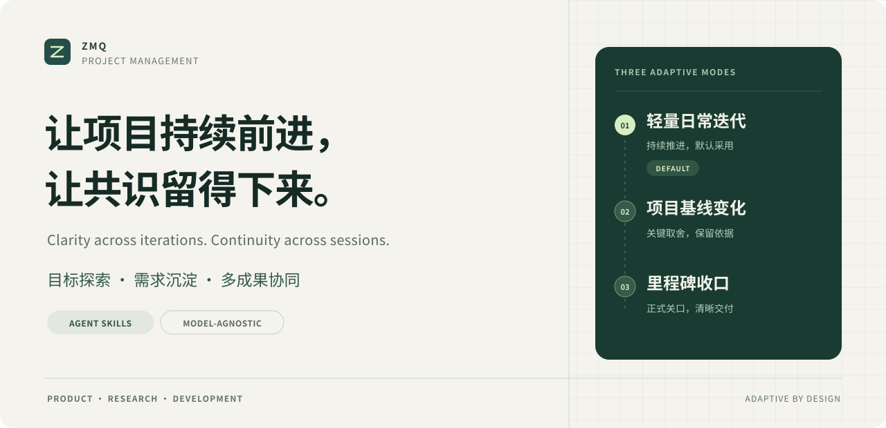

<p align="center">
  
</p>

<h1 align="center">ZMQ Project Management</h1>

<p align="center">
  面向 AI 协作的自适应项目管理 Skill<br>
  <sub>Clarity across iterations. Continuity across sessions.</sub>
</p>

<p align="center">
  <a href="https://github.com/night-silence-z/zmq-project-management/releases/tag/v2.2.0"></a>
  <a href="https://github.com/night-silence-z/zmq-project-management/actions/workflows/validate.yml"></a>
  <a href="LICENSE"></a>
  <a href="https://agentskills.io"></a>
</p>

<p align="center">
  <a href="https://github.com/night-silence-z/zmq-project-management/releases/download/v2.2.0/zmq-project-management-v2.2.0.zip">下载 v2.2.0 稳定版</a> ·
  <a href="#quick-start">安装与使用</a> ·
  <a href="#operating-modes">何时升级流程</a> ·
  <a href="#validation">验证与边界</a>
</p>

<a id="capabilities"></a>

## v2.2.0：小改直接做，规则变了才记

在同一个 Demo 上改按钮间距，改完检查界面就够了。若用户确认“取消的订单不计入成交额”，就更新当前需求，只复核采用这条口径的报表。这个 Skill 帮 AI 判断哪些变化值得留下，也让人不翻聊天记录就能找到成果。

<a id="workflows"></a>

| 遇到的事 | v2.2.0 怎么处理 |
| :-- | :-- |
| 日常迭代，反馈有大有小 | 局部样式改动不写管理记录；业务规则变了，就在原需求里替换旧规则。AI 为试用暂定的做法，不记作用户已确认。 |
| 子项目 B 引用了 A 报告的一段结论 | 注明出处和 B 实际采用的部分，原文仍由 A 维护。这不等于其他子项目也得遵守；只有明确共用的定义才作为共享约定。 |
| 同事问“经营周报现在改哪份，上次发的是哪份？” | 在已有入口用“经营周报”这样的业务名，分别指向当前工作稿、上次正式交付及其依据。不为导航搬文件、复制正文。 |
| 输入修正后，几份成果可能受影响 | 沿实际依赖检查受影响的计算或结论，保留项目必需检查。仍适用的证据可以复用；需要用户试用时，说清操作和预期。 |

它不是新的任务管理平台。已有文档、Issue、目录和版本控制都可以继续用；独立小任务不需要先建项目档案。

<a id="quick-start"></a>

## 安装与使用

1. [下载 v2.2.0 技能包（ZIP）](https://github.com/night-silence-z/zmq-project-management/releases/download/v2.2.0/zmq-project-management-v2.2.0.zip)。
2. 解压，把 **`zmq-project-management/` 整个目录**放入所用 AI Agent 的技能目录，保留目录名。升级时先备份再替换旧技能目录，不需要迁移业务项目或改写历史成果。
3. 在项目对话中点名技能，交代实际要做的事：

   ```text
   使用 $zmq-project-management。继续改订单 Demo：
   取消的订单不再计入成交额。请更新当前需求，并告诉我怎么试这条规则。
   ```

也可以克隆仓库，再取出同名技能目录；`evals/`、`tests/` 和 CI 配置不是安装所需。

```bash
git clone https://github.com/night-silence-z/zmq-project-management.git
```

[v2.2.0 发布说明](https://github.com/night-silence-z/zmq-project-management/releases/tag/v2.2.0) · [从旧版本升级：完整变更记录](CHANGELOG.md)

<a id="operating-modes"></a>

## 何时升级流程

| 模式 | 触发条件 | 留下什么 |
| :-- | :-- | :-- |
| **轻量日常迭代（默认）** | 在原方向内探索、实现、纠错、试用或接续 | 只更新确实变了的需求、状态或成果入口。方向不清时先问影响下一步的问题，不以建档为前提。 |
| **项目基线变化** | 改变已确认的目标、边界、关键定义、承诺或验收依据 | 在维护该约定的原文里记下新决定、理由和影响范围。 |
| **里程碑收口** | 明确要求正式定稿、冻结、发布、阶段验收或移交 | 核对本次交付物、版本、有效证据和未决事项。 |

风险决定要查多深，不决定是否收口。“今天先到这”只需留个恢复点；迭代次数多，也不等于要冻结版本。

<a id="validation"></a>

## 验证与边界

**已实现、AI 已检查、用户已验收，是三个不同的状态。** 技能管理项目连续性，不替代设计、开发、分析或业务验收，也不扩大工具权限或对外发送范围。

仓库提供[自动化测试](tests/)、[行为评估场景与方法](evals/README.md)和 [CI 运行记录](https://github.com/night-silence-z/zmq-project-management/actions)。[历史试跑记录](evals/trial-2.1.0-rc.1.md)对应 2.1 预发布阶段的模拟场景，不是 v2.2.0 的真实项目验收，也不能据此推算 token 或工时节省比例。

<details>
<summary><strong>给维护者：目录与本地验证</strong></summary>

```text
zmq-project-management/      # 可独立安装的技能包
  SKILL.md                  # 核心判断与按需路由
  agents/openai.yaml        # UI 元数据
  references/               # 按待解决的问题选读
  assets/templates/         # 可选项目模板
  scripts/                  # 初始化、定向健康检查、术语检查
docs/assets/                # 仓库介绍页封面
evals/                      # 行为场景与评分工具
tests/                      # 标准库自动化测试
```

```bash
python -m unittest discover -s tests -v
python evals/build_fixtures.py
python evals/score_run.py --help
```

评估夹具默认写入隔离临时目录。机器检查通过后，仍需审阅代理的实际行为与产物。

</details>

---

<p align="center">
  <strong>项目可以持续演进，共识不必每次重来。</strong><br>
  <sub>Built for thoughtful AI collaboration · <a href="LICENSE">Apache License 2.0</a></sub>
</p>
